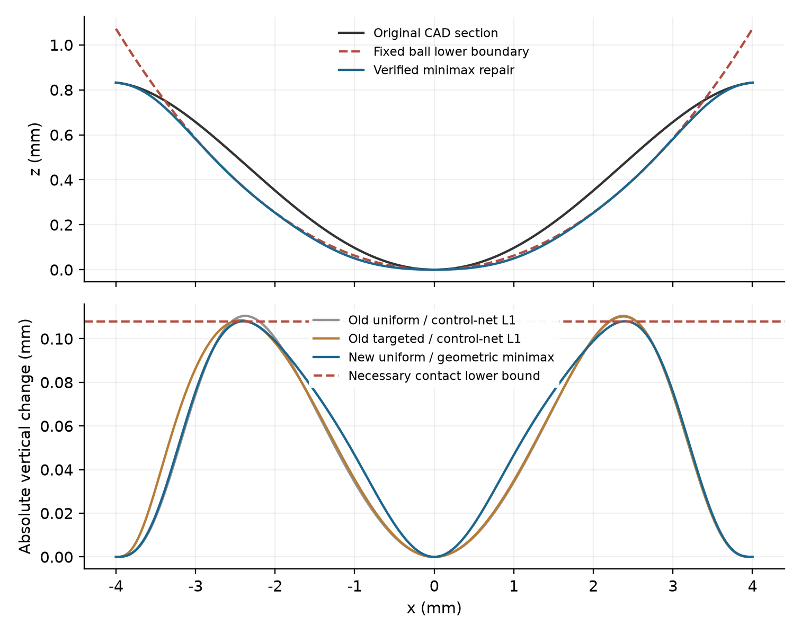
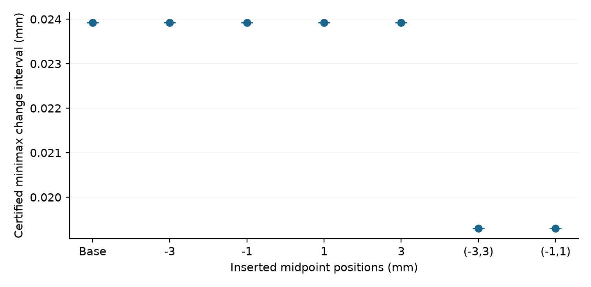

# 可核验最小改动 CAD 修正算法与专利候选推进报告

灵境制造科研项目 · 2026 年 11 月 9 日 · 探索性研究阶段

本轮把“改得尽量小”落实为可复核的连续几何优化问题，完成了精确设计锁定、实际改变量上下界、失败原因分流和 STEP 回读后的预算检查。14 组配置、7 种策略共 98 次运行全部留存，另完成 11 次成组精化诊断。

**当前尚未确立一个可授权的新算法。** 主要改进来自更合理的优化目标和验证方法；直接采用较丰富表示的传统基线也能取得同等质量。新发现的研究线索是：单个节点没有可观收益，不代表多个节点没有协同收益。它有可复核数值证据，但普通成对精化同样有效，仍需证明新的选择机制及其技术效果。

### 对照老师提出的四个重点

| 重点 | 本轮证据与实际状态 |
| --- | --- |
| ANSYS 模拟准确 | 未增加 ANSYS 模型或结果；当前是解析刀球几何约束，不能替代切削力、温度或变形验证。 |
| 足够且准确的样本 | 3 个相关解析截面、14 组配置；98 次是算法运行数，独立工业零件数为 0，高保真切削训练样本数为 0。 |
| 工艺与图纸的物理关系 | 已明确球刀半径、曲面曲率、包络侵入与允许几何改动的关系；范围限于局部几何前置条件。 |
| 修改深度学习模型 | 本轮实现传统优化与标签生成底座，尚未训练新网络；后文给出具体输入、输出与监督量。 |

相对上一轮，停止把“控制点更少”直接等同于“修正更好”，也不把没有证明完成当作设计不可加工。

<!-- page -->
## 1 机械定义：先把刀球与工件的关系说准确

采用局部截面 x ∈ [−4,4] mm，原曲线 z₀(x)=0.1x²−0.003x⁴，材料位于图形下方。刀球半径 r 为 6 或 8 mm，截面球心固定在 (0,r)，原点位置和一阶导数保留。两端位置、一阶和二阶导数保留，使局部编辑能够与既有侧面保持该特例下的 C2 拼接。

刀球下缘 hᵣ(x)=r−√(r²−x²)。本问题要求修正后的目标曲线 z(x) ≤ hᵣ(x)+ε，并满足实际竖向最大改变量 T = supₓ |z(x)−z₀(x)| ≤ B。B 是本算例给定的编辑预算，不是经图纸批准的尺寸公差。

### 为什么刀球尺寸能约束 CAD 形状

在原点，原曲线斜率为零、曲率为 0.2 mm⁻¹，对应曲率半径 5 mm；r=8 mm 的刀球下缘曲率为 1/8=0.125 mm⁻¹。两者原点相切时，原曲线在邻域抬升更快，造成球体与应保留材料相交。调整局部几何可以解除这个冲突，但必须保留被明确锁定的设计条件。

在零侵入容差且二阶可微的这个相切特例中，z″(0) ≤ 1/r 是局部必要条件。它不能代替整个截面的包络检查，更不能独立证明完整刀轨可达。

### 范围与单位

ε=10⁻⁶ mm 是理想几何算例的计算性允许侵入量，不是正安全距离，不代表工件公差或机床精度。报告中的纳米级界差都是模型内数值结果。这里没有刀柄、进退刀、装夹、毛坯、载荷、材料本构、热效应和切削变形。

把通过后的截面沿横向挤出，复用项目内核构造三片开放曲面。它是 open face compound，尚非封闭加工实体。通过一个固定姿态的刀球检查，也不意味着生成了合格的 NC 加工方案。

<!-- page -->
## 2 已实现算法：以实际几何改变量为目标

原方法最小化控制网 L1 改动，并用控制点盒约束间接限制曲面位移。这个目标随表示改变，不能公平比较不同节点配置。本轮改为求解连续几何的 minimax 问题：最小化 T，约束整条曲线的 |z−z₀|≤T、刀球包络以及全部指定锁定条件。

### 把锁定条件从惩罚项变成精确等式

设控制点增量为 δ，设计锁定写作 Eδ=0。使用有理数消元求零空间 N，并令 δ=N y。这样候选在数学表示中精确保留锁定值及导数；不需要用损失权重“尽量保留”硬要求。节点插入也用有理数执行，保持原曲线不变。

### 求解与接受步骤

| 步骤 | 已实现动作 |
| --- | --- |
| 1 必要条件检查 | 检查锁定点侵入，以及 z₀−B 的连续侵入反例；有此类证据才判相应冲突。 |
| 2 放松问题 | 用有限位置构成 LP；球面高度取向外有理包络，求可核验的目标下界。 |
| 3 搜索候选 | 用更严格的接触余量搜索；在接近 minimax 最优值的范围内，以固定网格 L1 作为次级选择，减少退化解的振荡。 |
| 4 连续分离 | 全域检查接触与实际位移；从各个侵入区间增加有理数反例，再求解。 |
| 5 最优性与预算 | 接触通过、上下界间隙达标、实际改变量不超过 B，才接受候选。 |
| 6 表示精化 | 比较均匀、对偶局部和逐区间试探；每次试探均计入成本，并保留已通过的最佳候选。 |
| 7 导出后再验 | STEP 回读后重新检查设计、接触及实际改变量预算。 |

有限采样用于搜索，不能作为连续验收。次级网格目标也不能取代主目标的连续上下界。LP、节点插入、零空间消元和反例迭代均是已有方法，不以这些组成部分单独主张首创。

<!-- page -->
## 3 上下界证据：哪些结论能成立

### 固定表示内的下界

将有限位置的放松问题写成 min cᵀv，满足 Av≤b，变量自由。若有 λ≥0 且 Aᵀλ=−c，则 L=−bᵀλ 是合法下界。程序只利用数值求解器提出的非零支持集，再以有理数重新解出乘子，并逐项检查符号、等式和目标值。仅有浮点残差小或“求解成功”标志不算证明。

### 连续可行候选的上界

传入二进制浮点数先解释为其精确有理数值。对刀球条件，令 U=r+ε−z，则在指定域内，z≤r−√(r²−x²)+ε 等价于 U≥0 且 U²−r²+x²≥0。用 Bernstein 凸包界与细分覆盖连续域；改变量用相同思路得到真实 sup |δz| 的界。

候选可行时，其实际改变量上界记为 Û；若 Û−L≤η，则证明距离**当前固定表示内**的最优值不超过 η。本轮 η=10⁻⁵ mm。超过证明预算必须返回未确定。

### 与表示无关的必要改变量

Lcontact 对应 max(0, supₓ[z₀(x)−hᵣ(x)−ε]) 的保守下界。它忽略锁定，因此同样是更难修正问题的下界；不能单独证明锁定后存在达到它的解。若已验证候选满足所有条件，则 Û−Lcontact 也可界定该理想模型内相对更广泛竖向编辑问题的差距。

| 状态 | 可以得出的结论 |
| --- | --- |
| 锁定点或 z₀−B 有侵入反例 | 相应固定姿态、锁定条件或编辑预算存在冲突；该证据不依赖节点数量。 |
| 固定表示下界高于 B | 该表示不能在预算内修复；仍不能宣布任意表示均无解。 |
| 搜索失败或验证未完成 | 仅为未确定，不得写成不可加工或安全通过。 |
| 候选通过且界差达标 | 只在声明的机械范围、编辑空间和数值模型内成立。 |

<!-- page -->
## 4 冻结对照：98 次运行的全部结果

3 个相关解析截面分别为原四次曲线、加入五次非对称项的曲线，以及较浅的四次曲线。两种半径分别配两档编辑预算，得到 12 组配置；另加 2 组明确冲突。每组运行 7 种策略。配置、源码 SHA256、请求和逐次历史在运行前冻结，源码指纹已核对一致。

这些是相关合成构造，不能当作独立工业零件。首个原曲线小试已观察过，完整矩阵仍是探索性研究，不称为独立盲测。

| 策略 | 可行 | 达质量门槛 | 预算冲突 | 点锁冲突 | 其余未确定 | LP 调用 |
| --- | --- | --- | --- | --- | --- | --- |
| 旧均匀 / 控制网 L1 | 7 | 0 | 4 | 1 | 2 | 346 |
| 旧靶向 / 控制网 L1 | 9 | 0 | 4 | 1 | 0 | 211 |
| 新 minimax 均匀 | 9 | 9 | 4 | 1 | 0 | 312 |
| 新 minimax 对偶局部 | 9 | 9 | 4 | 1 | 0 | 525 |
| 新逐区间试探 | 9 | 5 | 4 | 1 | 0 | 783 |
| 直接 13 控制点 | 9 | 9 | 4 | 1 | 0 | 165 |
| 直接 21 控制点 | 9 | 9 | 4 | 1 | 0 | 198 |

“可行”包含已通过预算但未达到目标质量的结果。“达质量门槛”是统一复算 Û−Lcontact≤10⁻⁴ mm；直接表示策略自身返回预算通过，表中另用同一指标复算其质量。新方法 45 个接受结果均回放了有理数下界、精确设计锁定和连续可行性。

### 竞争解释得到支持

统一实际几何目标后，均匀和对偶局部方法均达到质量门槛；但直接 13 控制点同样做到，而且 LP 调用更少。新局部选择规则没有显示出超过该强基线的整体收益。逐区间试探有 4 组只达到预算要求，消耗反而更多，应保留为负结果。

LP 次数不是等量浮点运算；精确计算、变量数量和验证成本不同。单次墙钟时间也受预热及执行顺序影响，不据此宣布通用速度优势。

<!-- page -->
## 5 代表案例：减少改动的收益来自哪里

r=8 mm、B=0.15 mm；各方法均保留原点位置与一阶导数、两端 C2 条件。接触必要改变量的界为 [0.1079802513, 0.1079803109] mm。

| 方法 | 控制点 | 实际最大改变量上界 / mm | LP 调用 |
| --- | --- | --- | --- |
| 旧均匀 | 13 | 0.1104437910 | 41 |
| 旧靶向 | 13 | 0.1101993105 | 33 |
| 新 minimax 均匀 | 13 | 0.1079826101 | 38 |
| 直接 13 控制点 | 13 | 0.1079826101 | 18 |

新均匀候选上界与必要下界相差约 0.000002359 mm。图中曲线仅用于展示，表中界来自连续有理数计算。直接 13 控制点取得相同候选，说明此处改善来自几何目标与求解方式，不足以证明自适应策略新颖或更强。

<!-- page -->
## 6 新线索：单步停滞掩盖了成组收益

观察完整结果后，另做 11 次事后诊断：固定 r=6 mm、B=0.15 mm、9 控制点表示与全部锁定；测试原表示、4 个候选中点逐个加入，以及全部 6 种配对。每个结果均独立回放连续可行性和上下界，排除“只是求解器没有证明完”的解释。

原表示最优改变量界约为 [0.0239205543, 0.0239227431] mm。利用各单节点问题的最优值下界，可以证明任意单独插入一个候选节点，改善最多 0.0000022204 mm。加入 (−1,1) mm 这一对节点后的候选上界为 0.0193009897 mm，改善至少 0.0046195645 mm。

### 可以与不能推出什么

这证明，在这个锁定与接触条件共同存在的算例中，“单步必须立即显著改善”的选择规则会漏掉成组收益。不能据此断言所有停滞都由锁定条件造成；多处极值、对偶退化和形状对称也可能参与，尚需消融区分。

普通对称成对插点就能得到相同量级收益，因此该现象本身不是专利创造性的证明。下一个候选应研究如何低成本识别这种协同，而非给普通两步搜索改名。

<!-- page -->
## 7 收紧后的候选与人工智能方案

候选暂称“利用可核验协同增益选择节点组的受保护 CAD 修正”。目前已完成最小改动求解器、成组诊断及 6 个配对标签，尚未完成新的学习选择器，也未确证专利新颖性。

### 给学习器一个明确、可复核的监督量

设 T₀ 为当前表示最优改变量，Tᵢ、Tⱼ 为单节点精化后的最优值，Tᵢⱼ 为成对精化后的最优值。定义普通离散交互量 Sᵢⱼ=Tᵢ+Tⱼ−Tᵢⱼ−T₀。由已验证的各目标区间，可得其下界 Lᵢ+Lⱼ−Uᵢⱼ−U₀。下界大于零，说明成组收益严格超过单独收益相加。

(−1,1) 这一配对的 S 界约为 [0.0046173757, 0.0046259484] mm。6 组配对标签均保留有理数区间与源证据指纹。这个离散交互量本身是通用数学量，不单独声称原创。

### 拟实现的网络职责

输入包括归一化曲线与节点、r、B、锁定掩码、当前上下界、接触反例位置，以及锁定零空间对候选区间的影响。采用 x/r、z/r、B/r 统一尺度；二阶导数按 r·z″ 变换，不能把不同物理量直接混用。

输出为候选节点组的排序与代价预测。固定表示优化器继续计算具体 δ=N y，连续验证器决定是否接受；网络分数不能放松设计锁定、预算或改变未知状态。也不预设现有 LNN 架构适合该任务。

监督目标先区分“协同增益下界为正”和“证据仍不确定”，再预测验证后的收益与总计算成本。不能把包含零的区间硬标成负样本。精确验证器并非直接可微模块，可通过离线优化标签训练排序器，不能宣称已实现穿过有理数验证的梯度反传。

现有 6 个配对标签来自同一源截面，只够校验数据格式与算术，不足以训练或评价泛化。正式比较应按零件源或解析构造分组划分数据；同时报告离线标注成本、网络推理、后续优化与验证总成本，并与普通成对精化、两步搜索及直接丰富表示比较。

<!-- page -->
## 8 专利查新：哪些主张已受到先例约束

本轮为公开网页与原始专利文本、论文入口的定向查新；未完成所有同族、引文链、未公开申请及完整法律检索。以下区分已核实内容与本项目推断，不以搜索未命中当作新颖性证明。

| 原始来源 | 核实内容与对本项目的影响 |
| --- | --- |
| [US20220414284A1](https://patents.google.com/patent/US20220414284A1/en) | 权利要求 1—4 已描述二次目标、迭代生成点约束、检验区域约束及输出模型；说明书涉及 B-spline。单靠“反例迭代满足连续约束”不足以建立新意。 |
| [EP3877889B1](https://patents.google.com/patent/EP3877889B1/en) | 制造约束进入边界生成设计已有公开授权文本；其任务为 2.5 轴约束，不能笼统主张首次用加工要求引导 CAD。 |
| [Farouki 等，2024 在线公开](https://arxiv.org/abs/2402.09850) | PH 曲线有界修改及端点、端切向保持已有研究；与本轮球刀及 minimax 范围不同，但“保形的小改动”不是空白。 |
| [Han，SSRN，2026-07-21](https://ssrn.com/abstract=7152574) | 公开摘要描述端点保持 PH 曲线的分支完整验证、区间算术与连续约束。此次核查限于摘要和页面信息，未将其视为同行评审结论或等同于本算法。 |
| [现行审查指南修改决定](https://www.cnipa.gov.cn/art/2025/11/13/art_74_202560.html) | 2026-01-01 起施行的修改强调算法与技术特征的联系及相应公开要求。仅增加网络或改算法名称，不能替代具体技术贡献。 |

### 当前判定

可实施性：在声明的受限模型内，已有源码、完整运行、精确证据与回读样例。新颖性：尚未确认具体权利要求组合相对单一先例存在足够区别。创造性：普通直接优化和成对精化仍能解释已见收益，证据不足。

多个来源分别覆盖若干部件，不自动等于某一完整权利要求丧失新颖性；同样，没有找到一篇覆盖全部内容，也不能自动证明创造性。当前可以整理候选技术材料，尚不能把它表述为已经找到“可授权算法”。

候选要继续保留，必须实现比普通成对搜索更具体的选择机制，并在相同质量、设计锁定和总预算下给出可复核技术效果；否则应放弃该算法主张，保留求解与验证资产。

<!-- page -->
## 9 测试、交付与下一阶段判定线

54 项测试通过，当前原型相关模块总行覆盖率 96.73%，各模块均超过 80%。测试覆盖精确基函数与独立 SciPy 核对、设计零空间、对偶证据篡改、未知状态、实际位移界、完整冻结比较，以及真正的 STEP 回读。

在临时副本中分别取消乘子非负检查、对偶等式检查、实际预算检查、精确锁定检查和回读预算检查，5 个故意错误均被相应测试检出；原源码指纹未变。这些证据验证程序防线，不等于现实切削模型正确或工业安全等级。

### STEP 检查的实际结果

代表候选输出为 3 片开放曲面。回读后，4 条挤出方向控制曲线均通过连续接触检查，实际改变量上界均约为 0.1079826100493 mm，低于 0.15 mm 预算。导出前设计锁定是精确有理等式；回读后的锁定使用既有内核数值审计，不能继续声称严格有理相等。

### 接下来值得做的事情

先用锁定阶次、对称性与活跃接触区域的干预区分协同来源；再实现能预测节点组而非只看单点分数的选择器。只在非对称曲线、多固定姿态及更丰富几何中，超过普通成对精化和直接丰富表示，才继续主张算法贡献。学习器的成本比较必须包含标注和失败处理。

若不能取得同等几何质量下更少的总计算或表示成本，应明确淘汰这一选择规则。完整加工有效性仍要通过封闭实体、全刀轨及经验证的力学模型补齐，不能用当前截面结果替代老师要求的 ANSYS 精度与数据规模。

### 复核入口（项目根目录 D:/灵境制造）

research/prototypes/contact_repair_evidence/README.md

research/prototypes/contact_repair_evidence/artifacts/envelope_20261109_01/

research/prototypes/contact_repair_evidence/artifacts/coupling_probe_20261109.json

research/prototypes/contact_repair_evidence/artifacts/envelope_mutation_20261109.json

research/prototypes/contact_repair_evidence/artifacts/coverage_20261109_final.json

docs/reports/algorithm_report_20261109/analysis.json 与 interaction_targets.json

本轮推进了真实可复核的算法底座，排除了两种夸大的创新解释，并形成了更窄的协同选择候选；没有把候选、计划或有限算例包装成已获授权的新算法。
