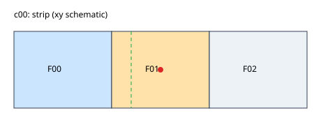
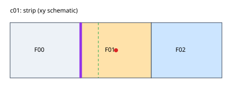
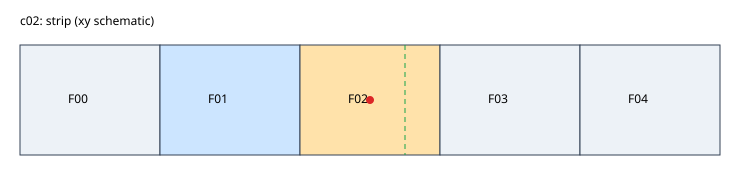
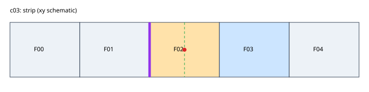
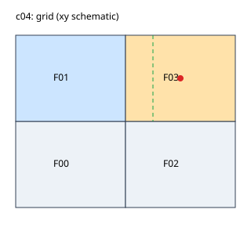
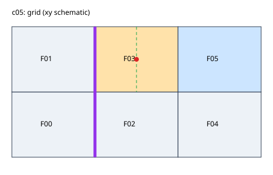
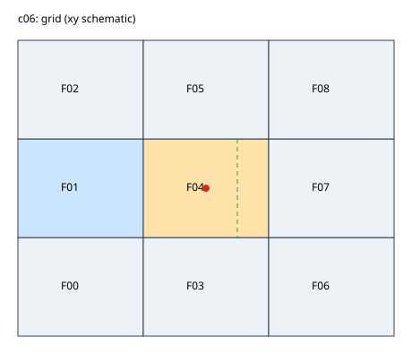
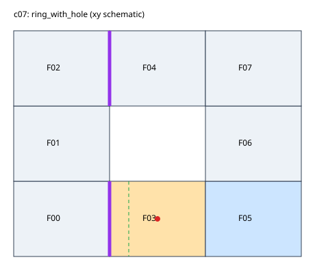
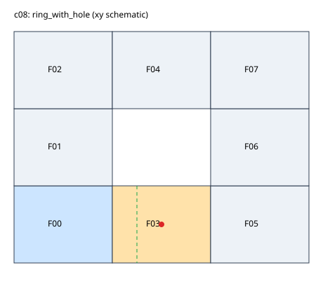
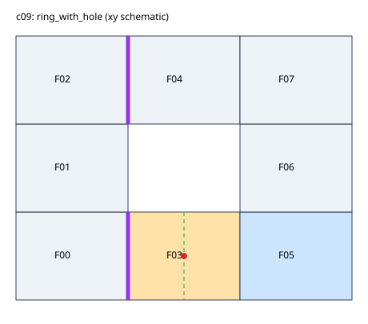

# 10 个几何案例 / 30 条需求审核板

状态：实施助手撰写并自动核查；独立人工审核全部 pending。

每个几何的橙色面为目标，蓝色面为安装接口，绿色虚线为检测截面，红点为目标点，紫色边为真实锐边。SVG 是 xy 邻接示意，实际形状见 STEP。

公共约定：边界含孔口位置固定；光滑接缝为匹配物理参数 C2；锐边保留位置及原一阶切向。

## c00 · strip

目标面 F01；接口面 F00；检测截面 u=0.2。

### c00_A

把标出的过渡片中心向上调 1 mm。安装接口那整片保持交付时的样子，其他过渡片可以跟着调整；可以细化表示，但先争取不增加控制网规模。

- 自动枚举选择：expand_1_2
- 可行候选：knots_u, knots_uv, knots_uv_dense, degree_uv8, expand_1_2
- 诊断：按几何与约束枚举可行方案；弱候选失败不等于任务无解。
- 独立审核人：______；文本与契约一致：□；几何角色正确：□；可行性复核：□；结论：______

### c00_B

这一版不许增加控制点。把目标片中心抬高 1 mm，检测截面轮廓仍要与原件重合；过渡带可以随动。

- 自动枚举选择：expand_0_1_2
- 可行候选：expand_0_1_2
- 诊断：按几何与约束枚举可行方案；弱候选失败不等于任务无解。
- 独立审核人：______；文本与契约一致：□；几何角色正确：□；可行性复核：□；结论：______

### c00_C

只修目标片内部，中心增高 1 mm。周围各片一概不动，标注的检测截面也不能变化；需要时可增加曲面自由度。

- 自动枚举选择：degree_uv8
- 可行候选：knots_uv_dense, degree_uv8
- 诊断：按几何与约束枚举可行方案；弱候选失败不等于任务无解。
- 独立审核人：______；文本与契约一致：□；几何角色正确：□；可行性复核：□；结论：______

## c01 · strip

目标面 F01；接口面 F02；检测截面 u=0.25。

### c01_A

目标片中点上移 1 mm，装配接口整片保持原状。过渡区可联动，既有折线别磨掉；先避免增加控制点，再考虑缩小修改面数。

- 自动枚举选择：knots_u
- 可行候选：knots_u, knots_uv, knots_uv_dense, degree_uv8
- 诊断：按几何与约束枚举可行方案；弱候选失败不等于任务无解。
- 独立审核人：______；文本与契约一致：□；几何角色正确：□；可行性复核：□；结论：______

### c01_B

控制网数量已冻结。中点上调 1 mm，指定检测截面继续作为原轮廓检具，其他过渡片可以动；保持原来的折线。

- 自动枚举选择：expand_1_2
- 可行候选：expand_1_2, expand_0_1_2
- 诊断：按几何与约束枚举可行方案；弱候选失败不等于任务无解。
- 独立审核人：______；文本与契约一致：□；几何角色正确：□；可行性复核：□；结论：______

### c01_C

中点提高 1 mm，只允许在目标片内消化修改；邻面和检测截面保持交付形状。可以加密，折线两侧的原切向必须保留。

- 自动枚举选择：knots_u
- 可行候选：knots_u, knots_uv, knots_uv_dense, degree_uv8
- 诊断：按几何与约束枚举可行方案；弱候选失败不等于任务无解。
- 独立审核人：______；文本与契约一致：□；几何角色正确：□；可行性复核：□；结论：______

## c02 · strip

目标面 F02；接口面 F01；检测截面 u=0.75。

### c02_A

五片过渡面中，只把标注片的中心抬高 1 mm；接口片不参与调整，其他片可以联动。优先沿用现有控制网，必要时再细化。

- 自动枚举选择：expand_0_2_3_4
- 可行候选：knots_u, knots_uv, knots_uv_dense, degree_uv8, expand_0_2_3_4
- 诊断：按几何与约束枚举可行方案；弱候选失败不等于任务无解。
- 独立审核人：______；文本与契约一致：□；几何角色正确：□；可行性复核：□；结论：______

### c02_B

沿用现有控制网，把目标片中心调高 1 mm。检测截面不变，其余过渡片可联动，不要求最小修改面数。

- 自动枚举选择：expand_0_1_2_3_4
- 可行候选：expand_0_1_2_3_4
- 诊断：按几何与约束枚举可行方案；弱候选失败不等于任务无解。
- 独立审核人：______；文本与契约一致：□；几何角色正确：□；可行性复核：□；结论：______

### c02_C

目标中心提高 1 mm，变化必须止于目标片边界。检测截面不能偏离，允许内部细化，不许靠改邻面来完成。

- 自动枚举选择：degree_uv8
- 可行候选：knots_uv_dense, degree_uv8
- 诊断：按几何与约束枚举可行方案；弱候选失败不等于任务无解。
- 独立审核人：______；文本与契约一致：□；几何角色正确：□；可行性复核：□；结论：______

## c03 · strip

目标面 F02；接口面 F03；检测截面 u=0.5。

### c03_A

中心加高 1 mm，安装接口与既有折线保持原样。过渡片可调整，优先不要加控制点；做不到时才考虑细化。

- 自动枚举选择：knots_u
- 可行候选：knots_u, knots_uv, knots_uv_dense, degree_uv8
- 诊断：按几何与约束枚举可行方案；弱候选失败不等于任务无解。
- 独立审核人：______；文本与契约一致：□；几何角色正确：□；可行性复核：□；结论：______

### c03_B

保持控制网规模，把中心向上移 1 mm，同时让图中的基准检测截面完全保留原位置和轮廓。允许过渡面联动。

- 自动枚举选择：有限动作集合内无可行候选
- 可行候选：无
- 诊断：固定截面穿过目标点，要求原位与非零位移直接冲突。
- 独立审核人：______；文本与契约一致：□；几何角色正确：□；可行性复核：□；结论：______

### c03_C

中心上调 1 mm，限于目标片内部改形；所有邻面、原折线和检测截面保持不动。允许加密，不允许默默取消任何一项要求。

- 自动枚举选择：有限动作集合内无可行候选
- 可行候选：无
- 诊断：固定截面穿过目标点，要求原位与非零位移直接冲突。
- 独立审核人：______；文本与契约一致：□；几何角色正确：□；可行性复核：□；结论：______

## c04 · grid

目标面 F03；接口面 F01；检测截面 u=0.25。

### c04_A

四片拼接区域的目标片中心提高 1 mm。接口片保持原形，其他片可联动；可增加自由度，但优先复用现有控制网。

- 自动枚举选择：knots_uv
- 可行候选：knots_uv, knots_uv_dense, degree_uv8
- 诊断：按几何与约束枚举可行方案；弱候选失败不等于任务无解。
- 独立审核人：______；文本与契约一致：□；几何角色正确：□；可行性复核：□；结论：______

### c04_B

四片区域继续使用原控制网。目标中心上移 1 mm，指定检测截面轮廓不变，允许周边面一起调整。

- 自动枚举选择：expand_0_1_2_3
- 可行候选：expand_0_1_2_3
- 诊断：按几何与约束枚举可行方案；弱候选失败不等于任务无解。
- 独立审核人：______；文本与契约一致：□；几何角色正确：□；可行性复核：□；结论：______

### c04_C

目标片中心提高 1 mm，另外三片原样保留。指定检测截面仍要通过原来的检具，可以增加目标片自由度。

- 自动枚举选择：knots_uv
- 可行候选：knots_uv, knots_uv_dense, degree_uv8
- 诊断：按几何与约束枚举可行方案；弱候选失败不等于任务无解。
- 独立审核人：______；文本与契约一致：□；几何角色正确：□；可行性复核：□；结论：______

## c05 · grid

目标面 F03；接口面 F05；检测截面 u=0.5。

### c05_A

把目标片的中部抬高 1 mm。接口片整体不变，其他过渡面可随动；保留图中折线，先不增加控制网规模。

- 自动枚举选择：knots_uv
- 可行候选：knots_uv, knots_uv_dense, degree_uv8
- 诊断：按几何与约束枚举可行方案；弱候选失败不等于任务无解。
- 独立审核人：______；文本与契约一致：□；几何角色正确：□；可行性复核：□；结论：______

### c05_B

控制网不能扩容。中点抬高 1 mm，同时保持检测截面原样；过渡面可动，所有要求都必须保留。

- 自动枚举选择：有限动作集合内无可行候选
- 可行候选：无
- 诊断：固定截面穿过目标点，要求原位与非零位移直接冲突。
- 独立审核人：______；文本与契约一致：□；几何角色正确：□；可行性复核：□；结论：______

### c05_C

只改目标片，中点提高 1 mm。邻面、折线和基准检测截面保留原状，需要时允许加密。

- 自动枚举选择：有限动作集合内无可行候选
- 可行候选：无
- 诊断：固定截面穿过目标点，要求原位与非零位移直接冲突。
- 独立审核人：______；文本与契约一致：□；几何角色正确：□；可行性复核：□；结论：______

## c06 · grid

目标面 F04；接口面 F01；检测截面 u=0.75。

### c06_A

九片区域中，目标片中点增加 1 mm 高度。装配接口那片完全不动，其他过渡片允许联动；优先使用原来的控制网。

- 自动枚举选择：expand_0_2_3_4_5_6_7_8
- 可行候选：knots_uv, knots_uv_dense, degree_uv8, expand_0_2_3_4_5_6_7_8
- 诊断：按几何与约束枚举可行方案；弱候选失败不等于任务无解。
- 独立审核人：______；文本与契约一致：□；几何角色正确：□；可行性复核：□；结论：______

### c06_B

不要新增控制点，把目标中心抬高 1 mm。保留标注截面的原轮廓，可以联动调整其他过渡片。

- 自动枚举选择：expand_0_1_2_3_4_5_6_7_8
- 可行候选：expand_0_1_2_3_4_5_6_7_8
- 诊断：按几何与约束枚举可行方案；弱候选失败不等于任务无解。
- 独立审核人：______；文本与契约一致：□；几何角色正确：□；可行性复核：□；结论：______

### c06_C

九片区域里只调整目标片，中心提高 1 mm。八个邻域面都保持原样，检测截面也保持原样；可以细化目标片。

- 自动枚举选择：degree_uv8
- 可行候选：knots_uv_dense, degree_uv8
- 诊断：按几何与约束枚举可行方案；弱候选失败不等于任务无解。
- 独立审核人：______；文本与契约一致：□；几何角色正确：□；可行性复核：□；结论：______

## c07 · ring_with_hole

目标面 F03；接口面 F05；检测截面 u=0.2。

### c07_A

环形区域的目标片中心提高 1 mm，安装接口整体不变。过渡带可随动，原折线保持；优先不增加控制点。

- 自动枚举选择：knots_u
- 可行候选：knots_u, knots_uv, knots_uv_dense, degree_uv8
- 诊断：按几何与约束枚举可行方案；弱候选失败不等于任务无解。
- 独立审核人：______；文本与契约一致：□；几何角色正确：□；可行性复核：□；结论：______

### c07_B

环形区域控制网已冻结。中心调高 1 mm，检测截面保留原形，允许过渡带联动；孔口仍按公共边界要求固定。

- 自动枚举选择：有限动作集合内无可行候选
- 可行候选：无
- 诊断：给定动作和控制点预算内未找到可行方案；不作一般曲面全局无解判断。
- 独立审核人：______；文本与契约一致：□；几何角色正确：□；可行性复核：□；结论：______

### c07_C

孔周其他曲面不参与修改，只把目标片中点提高 1 mm。检测截面与折线仍按原样保留，可以增加目标片自由度。

- 自动枚举选择：knots_u
- 可行候选：knots_u, knots_uv, knots_uv_dense, degree_uv8
- 诊断：按几何与约束枚举可行方案；弱候选失败不等于任务无解。
- 独立审核人：______；文本与契约一致：□；几何角色正确：□；可行性复核：□；结论：______

## c08 · ring_with_hole

目标面 F03；接口面 F00；检测截面 u=0.25。

### c08_A

孔周目标片的中心上移 1 mm。接口片保持原形，其余过渡片允许联动；先沿用已有控制网，不够时再细化。

- 自动枚举选择：knots_u
- 可行候选：knots_u, knots_uv, knots_uv_dense, degree_uv8
- 诊断：按几何与约束枚举可行方案；弱候选失败不等于任务无解。
- 独立审核人：______；文本与契约一致：□；几何角色正确：□；可行性复核：□；结论：______

### c08_B

不新增控制点，目标中心提高 1 mm，检测截面保持原轮廓。允许其他过渡片配合调整，孔口位置不变。

- 自动枚举选择：expand_0_1_2_3_4_5_6_7
- 可行候选：expand_0_1_2_3_4_5_6_7
- 诊断：按几何与约束枚举可行方案；弱候选失败不等于任务无解。
- 独立审核人：______；文本与契约一致：□；几何角色正确：□；可行性复核：□；结论：______

### c08_C

只在孔周的目标片内部增加 1 mm 中心高度。其余片和检测截面不变，允许细化目标片。

- 自动枚举选择：degree_uv8
- 可行候选：knots_uv_dense, degree_uv8
- 诊断：按几何与约束枚举可行方案；弱候选失败不等于任务无解。
- 独立审核人：______；文本与契约一致：□；几何角色正确：□；可行性复核：□；结论：______

## c09 · ring_with_hole

目标面 F03；接口面 F05；检测截面 u=0.5。

### c09_A

环形过渡区中心提高 1 mm。固定安装接口和原有折线，其他面可随动；先减少新增控制点，再减少影响面数。

- 自动枚举选择：knots_u
- 可行候选：knots_u, knots_uv, knots_uv_dense, degree_uv8
- 诊断：按几何与约束枚举可行方案；弱候选失败不等于任务无解。
- 独立审核人：______；文本与契约一致：□；几何角色正确：□；可行性复核：□；结论：______

### c09_B

环形控制网保持原规模。标注片的中点提高 1 mm，指定检测截面轮廓保持原样；必要时联动其他过渡片。

- 自动枚举选择：有限动作集合内无可行候选
- 可行候选：无
- 诊断：固定截面穿过目标点，要求原位与非零位移直接冲突。
- 独立审核人：______；文本与契约一致：□；几何角色正确：□；可行性复核：□；结论：______

### c09_C

标注片中点抬高 1 mm，修改不得传播到邻面。检测截面和折线不能变，可以加密目标片但不能省略约束。

- 自动枚举选择：有限动作集合内无可行候选
- 可行候选：无
- 诊断：固定截面穿过目标点，要求原位与非零位移直接冲突。
- 独立审核人：______；文本与契约一致：□；几何角色正确：□；可行性复核：□；结论：______
